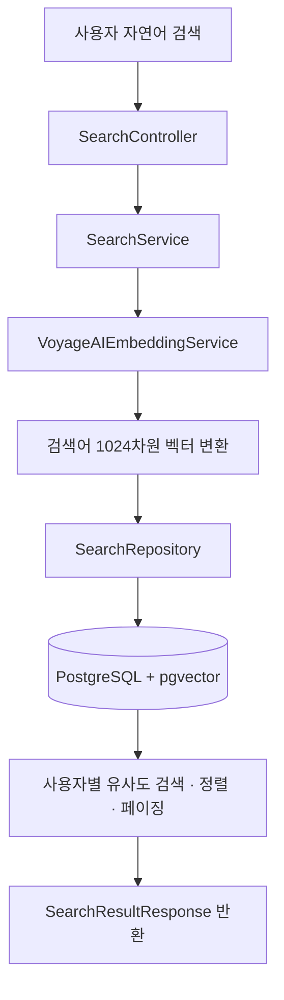

<div align="center">

# 📖 TADA

### AI 기반 감성 다이어리 · 자연어 일기 검색

**기억나는 문장만 입력해도, 의미가 비슷한 과거 일기를 찾아주는 검색 기능**

<br>


<br><br>

[**전체 프로젝트**](https://github.com/OhSSangHoon/tada-was) · [**내 검색 기능 코드**](https://github.com/halloween96/tada-was/tree/main/src/main/java/com/tada/tada/search) · [**검색 테스트 코드**](https://github.com/halloween96/tada-was/tree/main/src/test/java/com/tada/tada/search)

</div>

---

## 📌 프로젝트 소개

**TADA**는 사용자의 일기를 기록하고 AI를 활용해 회상할 수 있도록 돕는 다이어리 서비스입니다.

저는 팀 프로젝트에서 **백엔드 `search` 영역**을 담당했습니다. 과거 일기의 문구를 정확히 기억하지 못하더라도, 자연어 검색어를 벡터로 변환해 **내용의 의미가 가까운 일기를 찾는 기능**을 구현했습니다.

> **담당 범위**  
> 자연어 검색 REST API · Voyage AI 임베딩 연동 · pgvector 유사도 검색 · 정렬/페이지네이션 · 임베딩 비동기 갱신 · 단위 테스트

## 🛠 기술 스택

| 구분 | 사용 기술 |
| :--- | :--- |
| Language | Java 17 |
| Backend | Spring Boot, Spring Data JPA, Spring Security, Spring RestClient |
| Database | PostgreSQL, pgvector |
| AI | Voyage AI (`voyage-4`, 1024차원 임베딩) |
| Test | JUnit 5, Mockito |
| Collaboration | Git, GitHub |

## ✨ 주요 기능

| 기능 | 내용 |
| :--- | :--- |
| 🔎 **자연어 의미 검색** | 검색어를 임베딩해 의미상 유사한 과거 일기 조회 |
| 🔐 **사용자별 검색** | 로그인한 사용자가 작성한 일기만 조회 |
| ↕️ **정렬 및 페이징** | 관련도순, 최신순, 오래된순 / 페이지 단위 조회 |
| 🔄 **임베딩 자동 갱신** | 일기 생성·수정 후 이벤트 기반으로 검색 벡터 비동기 갱신 |
| 🛡️ **오류 대응** | 검색어 유효성 검증, 외부 API 429 응답 재시도 |
| 🧪 **단위 테스트** | 검색 결과 변환, 정렬 분기, 오류 흐름 검증 |

---

## 👨‍💻 담당 업무 및 주요 구현

### 01. 임베딩을 활용한 의미 기반 검색

- `VoyageAIEmbeddingService`에서 검색어를 **1024차원 벡터**로 변환
- `SearchRepository`에서 pgvector 코사인 거리 연산자 **`<=>`** 사용
- 임베딩이 존재하는 **`ACTIVE` 상태 일기**를 대상으로, 코사인 거리 **`0.7` 미만**의 결과 검색
- 키워드가 정확하게 일치하지 않아도 의미상 관련된 일기를 찾도록 구성

> `0.7`은 **코사인 거리 필터 기준**으로, 검색 정확도가 70%라는 의미가 아닙니다.

### 02. 사용자별 검색 API 및 결과 정렬

- `GET /api/search` 엔드포인트 구현
- Spring Security 인증 정보에서 **사용자 UUID**를 가져와 본인의 일기만 조회
- `SearchResultResponse` DTO로 검색 결과 응답
- `latest`(최신순), `oldest`(오래된순), `relevance`(관련도순) 제공
- `Pageable`을 이용해 페이지네이션 처리

### 03. 일기 저장 이후 임베딩 비동기 갱신

- `DiaryEmbeddingEventListener`로 일기 생성·수정 이벤트 수신
- `@TransactionalEventListener`를 이용해 **트랜잭션 커밋 이후** 처리
- `@Async`를 이용해 임베딩 생성 작업을 비동기로 분리
- 생성된 벡터를 DB의 검색용 임베딩 데이터에 반영

### 04. 예외 처리 및 테스트

- 빈 문자열·공백·`null` 검색어 검증
- Voyage AI의 **HTTP 429** 응답 시 **2초 대기 후 최대 1회 재시도**
- 개발 환경에서 임베딩이 누락된 기존 일기를 채우는 `DiaryEmbeddingBackfillRunner` 구현 (`@Profile("!prod")`)
- **JUnit 5 / Mockito**로 정상 결과, DTO 변환, 정렬 분기, 오류 상황 테스트

---

## 🔁 검색 처리 과정



### 검색 API

```http
GET /api/search?query=기분%20좋은%20날&page=0&size=3&sort=relevance
```

| 파라미터 | 설명 | 기본값 |
| :--- | :--- | :--- |
| `query` | 자연어 검색어 (필수) | 없음 |
| `page` | 페이지 번호 | `0` |
| `size` | 페이지당 결과 수 | `3` |
| `sort` | `latest` / `oldest` / `relevance` | `latest` |

<details>
<summary><b>📂 검색 기능 주요 소스 파일 보기</b></summary>

<br>

| 파일 | 역할 |
| :--- | :--- |
| `SearchController` | 검색 요청, 인증 정보 처리 |
| `SearchService` | 검색어 검증, 서비스 로직 및 DTO 변환 |
| `VoyageAIEmbeddingService` | Voyage AI 임베딩 API 연동 |
| `SearchRepository` | pgvector 코사인 거리 검색 |
| `DiaryEmbeddingEventListener` | 일기 생성·수정 후 임베딩 갱신 |
| `DiaryEmbeddingBackfillRunner` | 개발 환경의 기존 데이터 보완 |
| `SearchServiceTest` | 검색 서비스 단위 테스트 |

</details>

---

## 💡 프로젝트를 통해 배운 점

- **벡터 검색 구현:** 텍스트 임베딩과 pgvector를 연결하여 의미 기반 검색을 구현했습니다.
- **접근 범위 제한:** 인증 사용자 정보와 Repository 조건을 연계해 본인 데이터만 조회하도록 구성했습니다.
- **비동기 처리:** 이벤트 및 트랜잭션 커밋 후 처리 방식으로 일기 저장 작업과 임베딩 생성을 분리했습니다.
- **테스트:** 검색 결과 변환, 예외 상황, 정렬 조건을 단위 테스트로 검증했습니다.

### 향후 개선 방향

- 실제 검색 사례를 바탕으로 코사인 거리 임계값 조정
- 검색 품질 및 응답 시간 측정
- 외부 임베딩 API 장애 상황 모니터링 보강

---

<div align="center">

**Team Project · 개인 담당: Backend Search**

[맨 위로 올라가기 ↑](#-tada)

</div>
