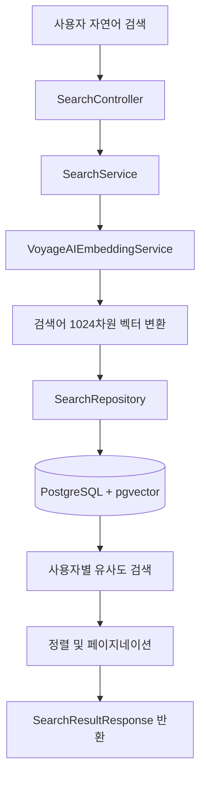

<div align="center">

# 📖 TADA

### AI 기반 감성 다이어리 · 자연어 일기 검색

**기억나는 문장만 입력해도, 의미가 비슷한 과거 일기를 찾아주는 검색 기능**

<br>


<br><br>

[**전체 프로젝트**](https://github.com/OhSSangHoon/tada-was) ·
[**내 검색 기능 코드**](https://github.com/halloween96/tada-was/tree/fix/search-cosine-distance/src/main/java/com/tada/tada/search) ·
[**검색 테스트 코드**](https://github.com/halloween96/tada-was/tree/fix/search-cosine-distance/src/test/java/com/tada/tada/search)

</div>

---

## 📌 프로젝트 소개

**TADA**는 사용자의 일기를 기록하고 AI를 활용해 회상할 수 있도록 돕는 다이어리 서비스입니다.

저는 팀 프로젝트에서 **백엔드 `search` 영역**을 담당했습니다.

과거 일기의 문구를 정확하게 기억하지 못하더라도, 자연어 검색어를 벡터로 변환하여 **내용의 의미가 가까운 일기를 찾는 기능**을 구현했습니다.

> **담당 범위**
>
> 자연어 검색 REST API · Voyage AI 임베딩 연동 · pgvector 유사도 검색 · 정렬/페이지네이션 · 임베딩 비동기 갱신 · 단위 테스트

---

## 🛠 기술 스택

| 구분 | 사용 기술 |
| :--- | :--- |
| Language | Java 17 |
| Backend | Spring Boot, Spring Data JPA, Spring Security, Spring RestClient |
| Database | PostgreSQL, pgvector |
| AI | Voyage AI (`voyage-4`, 1024차원 임베딩) |
| Test | JUnit 5, Mockito |
| Collaboration | Git, GitHub |

---

## ✨ 주요 기능

| 기능 | 내용 |
| :--- | :--- |
| 🔎 **자연어 의미 검색** | 검색어를 임베딩하여 의미상 유사한 과거 일기 조회 |
| 🔐 **사용자별 검색** | 로그인한 사용자가 작성한 일기만 조회 |
| ↕️ **정렬 및 페이징** | 관련도순, 최신순, 오래된순 및 페이지 단위 조회 |
| 🔄 **임베딩 자동 갱신** | 일기 생성·수정 후 이벤트 기반으로 검색 벡터 비동기 갱신 |
| 🛡️ **오류 대응** | 검색어 유효성 검증 및 외부 API 429 응답 재시도 |
| 🧪 **단위 테스트** | 검색 결과 변환, 정렬 분기, 오류 흐름 검증 |

---

## 👨‍💻 담당 업무 및 주요 구현

### 01. 임베딩을 활용한 의미 기반 검색

- `VoyageAIEmbeddingService`를 사용하여 검색어를 **1024차원 벡터**로 변환
- `SearchRepository`에서 PostgreSQL pgvector의 **코사인 거리 연산자 `<=>`** 사용
- 임베딩이 존재하는 `ACTIVE` 상태의 일기를 대상으로 유사도 검색 수행
- 코사인 거리 `0.7` 미만을 검색 결과 필터링 기준으로 적용
- 검색어와 일기 본문의 단어가 정확하게 일치하지 않더라도 의미상 관련된 일기를 검색하도록 구현

> **코사인 거리 기준**
>
> 코사인 거리는 벡터 간의 차이를 나타내는 값으로, 값이 작을수록 유사한 의미를 갖는 것으로 판단합니다.
>
> `0.7`은 검색 결과를 필터링하기 위한 거리 임계값이며, 검색 정확도 70%를 의미하지 않습니다.

### 02. 사용자별 검색 API 및 결과 정렬

- `GET /api/search` REST API 구현
- Spring Security 인증 정보에서 사용자 UUID를 가져와 검색 대상 제한
- 사용자 본인의 일기만 조회할 수 있도록 Repository 검색 조건 구성
- `SearchResultResponse` DTO를 이용해 검색 결과 반환
- `Pageable`을 이용한 페이지네이션 처리
- `latest`, `oldest`, `relevance` 정렬 기능 제공

**지원하는 정렬 방식**

| 정렬 옵션 | 설명 |
| :--- | :--- |
| `latest` | 최신 일기순 |
| `oldest` | 오래된 일기순 |
| `relevance` | 검색어와의 관련도순 |

### 03. 일기 저장 이후 임베딩 비동기 갱신

- `DiaryEmbeddingEventListener`를 이용하여 일기 생성·수정 이벤트 수신
- `@TransactionalEventListener`를 활용하여 트랜잭션 커밋 이후 임베딩 처리
- `@Async`를 사용해 임베딩 생성 작업을 비동기로 분리
- 생성된 임베딩 벡터를 DB에 반영하여 검색에 활용

**처리 과정**

1. 사용자가 일기를 작성하거나 수정
2. 일기 저장 트랜잭션 완료
3. 임베딩 갱신 이벤트 처리
4. Voyage AI를 이용한 일기 내용 벡터화
5. 생성된 벡터를 DB에 저장
6. 이후 자연어 검색 시 검색 대상에 반영

### 04. 예외 처리 및 테스트

- `null`, 빈 문자열, 공백 검색어에 대한 유효성 검증
- Voyage AI API에서 HTTP 429 응답 발생 시 **2초 대기 후 최대 1회 재시도**
- 기존 일기의 임베딩 누락을 보완하기 위한 `DiaryEmbeddingBackfillRunner` 구현
- `@Profile("!prod")`를 이용해 개발 환경에서만 백필 기능 실행
- JUnit 5와 Mockito를 이용한 `SearchService` 단위 테스트 작성
- 정상 검색, 결과 DTO 변환, 정렬 분기 및 오류 흐름 검증

---

## 🔁 검색 처리 과정



### 검색 API

**Endpoint**

```http
GET /api/search?query=기분%20좋은%20날&page=0&size=3&sort=relevance
```

**요청 파라미터**

| 파라미터 | 설명 | 기본값 |
| :--- | :--- | :--- |
| `query` | 자연어 검색어 (필수) | 없음 |
| `page` | 페이지 번호 | `0` |
| `size` | 페이지당 결과 수 | `3` |
| `sort` | `latest` / `oldest` / `relevance` | `latest` |

---

## 📂 주요 소스 코드

<details>
<summary><b>검색 기능 주요 소스 파일 보기</b></summary>

<br>

| 파일 | 역할 |
| :--- | :--- |
| `SearchController` | 검색 요청 및 인증 정보 처리 |
| `SearchService` | 검색어 검증, 서비스 로직 및 DTO 변환 |
| `VoyageAIEmbeddingService` | Voyage AI 임베딩 API 연동 |
| `SearchRepository` | pgvector 코사인 거리 검색 |
| `DiaryEmbeddingEventListener` | 일기 생성·수정 후 임베딩 갱신 |
| `DiaryEmbeddingBackfillRunner` | 개발 환경의 기존 임베딩 데이터 보완 |
| `SearchServiceTest` | 검색 서비스 단위 테스트 |

<br>

**소스 코드 바로가기**

- [검색 기능 전체 코드](https://github.com/halloween96/tada-was/tree/fix/search-cosine-distance/src/main/java/com/tada/tada/search)
- [검색 기능 테스트 코드](https://github.com/halloween96/tada-was/tree/fix/search-cosine-distance/src/test/java/com/tada/tada/search)

</details>

---

## 💡 프로젝트를 통해 배운 점

### 벡터 기반 검색 구현 경험

단순 문자열 비교 방식이 아닌 텍스트 임베딩과 pgvector를 활용해 의미 기반 검색을 구현했습니다.

이를 통해 자연어 데이터를 벡터로 변환하고 데이터베이스에서 유사도를 비교하는 검색 처리 과정을 경험했습니다.

### 사용자 데이터 접근 범위 제한

Spring Security 인증 정보와 Repository 검색 조건을 연계하여 로그인한 사용자의 데이터만 검색할 수 있도록 구현했습니다.

검색 기능에서도 사용자별 데이터 접근 범위를 고려하는 것이 중요하다는 점을 배웠습니다.

### 이벤트 기반 비동기 처리

일기 저장 이후 수행되는 임베딩 생성 작업을 이벤트 기반 비동기 처리로 분리했습니다.

이를 통해 데이터 저장과 추가 처리 작업의 실행 시점을 분리하는 방법을 익혔습니다.

### 단위 테스트 작성

JUnit 5와 Mockito를 이용해 검색 결과 변환, 정렬 조건 및 예외 상황을 검증했습니다.

외부 API와 Repository 의존성을 모의 객체로 대체하여 서비스 로직을 독립적으로 테스트하는 경험을 쌓았습니다.

### 향후 개선 방향

- 실제 검색 사례를 기반으로 코사인 거리 임계값 조정
- 검색 정확도 및 응답 시간 측정
- 외부 임베딩 API 장애 상황에 대한 모니터링 보강

---

<div align="center">

</div>
